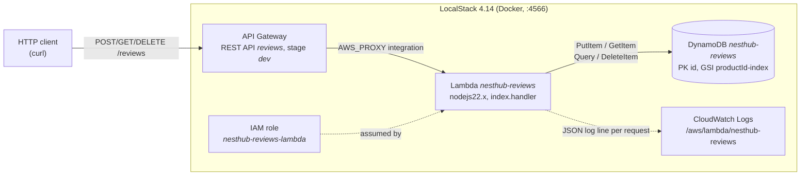

# NestHub reviews: serverless API on LocalStack

A small HTTP API for product reviews, built the AWS serverless way: **API Gateway → Lambda → DynamoDB**. It runs locally in [LocalStack](https://github.com/localstack/localstack), which emulates the AWS APIs on `http://localhost:4566`. Everything is created by one AWS CLI script.

## Architecture



| Component | Resource | Role |
| --------- | -------- | ---- |
| API Gateway | REST API `nesthub-reviews-api` (id `reviews`), stage `dev` | Routes HTTP requests to the function with a **Lambda proxy integration**: the whole request (method, path, query, body) goes to the function as the event, and its `{statusCode, headers, body}` becomes the HTTP response. |
| Lambda | `nesthub-reviews`, Node.js 22, [`lambda/reviews/index.mjs`](lambda/reviews/index.mjs) | Validates input and reads/writes DynamoDB with the AWS SDK v3, which is built into the runtime, so the deployment package is one file. |
| DynamoDB | table `nesthub-reviews`, on-demand | Partition key `id` (UUID). Global secondary index `productId-index` lists the reviews of a product without a full scan. |
| IAM | role `nesthub-reviews-lambda` | Assumed by Lambda. Inline policy allows only `PutItem`, `GetItem`, `DeleteItem`, `Query` on this table and its index, plus writing logs. LocalStack Community does not enforce IAM, but the policy is what real AWS would need. |
| CloudWatch Logs | `/aws/lambda/nesthub-reviews` | One JSON line per request: method, route, status, duration. |

One function serves all routes: the routes share the table, the validation and the error format, and one cold start serves them all. For a larger API each route can get its own function with no change to the table.

## API

Base URL: `http://localhost:4566/restapis/reviews/dev/_user_request_` (the same API is also at `http://reviews.execute-api.localhost.localstack.cloud:4566/dev`).

| Method | Path | Body / query | Response |
| ------ | ---- | ------------ | -------- |
| `POST` | `/reviews` | `{"productId": "...", "author": "...", "rating": 1-5, "text": "..."}` (`text` optional) | `201` + the created review with `id` and `createdAt`; `400` on invalid input |
| `GET` | `/reviews?productId=<id>` | | `200` + `{productId, count, items}`; `400` without `productId` |
| `GET` | `/reviews/{id}` | | `200` + the review; `404` if missing |
| `DELETE` | `/reviews/{id}` | | `204`; `404` if missing |

Errors are `{"error": "<message>"}`. Unknown method/route pairs answer `405`, unexpected failures `500` (logged).

## Run

Requirements: Docker, AWS CLI v2, `jq`, `zip`. No AWS account is used: every call goes to LocalStack with dummy credentials (see [`scripts/common.sh`](scripts/common.sh)).

```bash
# 1. LocalStack (Lambda functions run as sibling containers via the Docker socket)
docker compose -f serverless/docker-compose.yaml up -d --wait
curl -s localhost:4566/_localstack/health | jq '{edition, version}'

# 2. Deploy all resources (safe to run again)
./serverless/scripts/deploy.sh

# 3. End-to-end check with curl
./serverless/scripts/smoke-test.sh

# 4. Remove the resources / stop LocalStack
./serverless/scripts/destroy.sh
docker compose -f serverless/docker-compose.yaml down
```

`localstack/localstack:4.14.0` is the last free Community image: newer tags need a LocalStack account and auth token. LocalStack keeps no state across restarts, so after `up` run `deploy.sh` again.

Manual requests:

```bash
API=http://localhost:4566/restapis/reviews/dev/_user_request_/reviews

curl -s -X POST $API -H 'Content-Type: application/json' \
  -d '{"productId":"prod-1","author":"Olena","rating":5,"text":"Great"}' | jq
curl -s "$API?productId=prod-1" | jq
curl -s $API/<id> | jq
curl -s -X DELETE $API/<id> -w '%{http_code}\n'
```

Inspecting the resources:

```bash
source serverless/scripts/common.sh   # awsl = aws --endpoint-url http://localhost:4566
awsl dynamodb scan --table-name nesthub-reviews
awsl lambda get-function --function-name nesthub-reviews --query Configuration
awsl apigateway get-resources --rest-api-id reviews
awsl logs tail /aws/lambda/nesthub-reviews
```

## Deployment sequence (`scripts/deploy.sh`)

The order follows the dependencies: each step needs the resource of the previous one.

1. **DynamoDB table** with the `productId-index` GSI; wait until `ACTIVE`. Skipped if it exists, so data survives a redeploy.
2. **IAM role** with the Lambda trust policy, then the inline access policy (always rewritten).
3. **Lambda function**: zip `index.mjs`, create it (`nodejs22.x`, env `TABLE_NAME`) and wait until `Active`, or update the code of an existing one. The first start pulls the runtime image and takes longer.
4. **REST API**: recreated on every run, so its routes always match the script. Resources `/reviews` and `/reviews/{id}`, methods `POST`/`GET` and `GET`/`DELETE`, each with an `AWS_PROXY` integration to the function. Then `lambda add-permission` lets `apigateway.amazonaws.com` invoke the function for this API.
5. **Deployment** to the `dev` stage, which makes the routes callable.

## Tests

Unit tests of the handler run without AWS, with an in-memory stand-in for the DynamoDB client:

```bash
cd serverless && bun install && npm test
```
